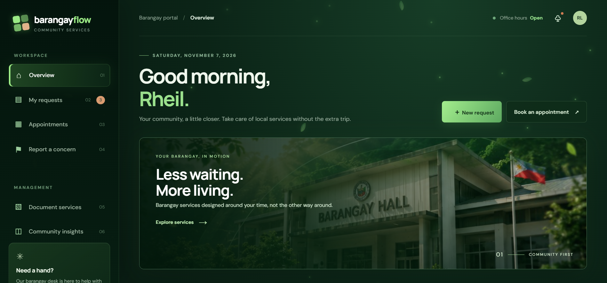
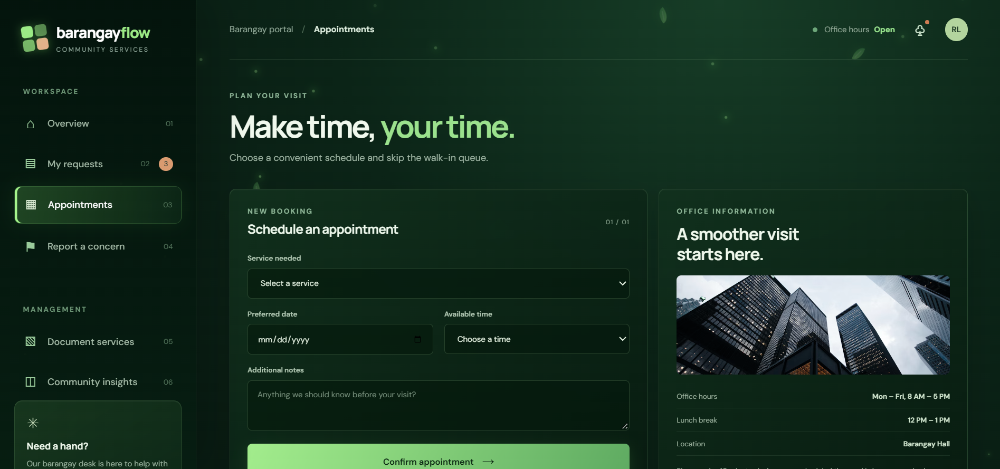

 <div align="center">


<br>

**A smarter, faster, and more connected barangay.**

A modern digital barangay services platform designed to make public services more accessible, organized, and convenient for residents.

<br>

[](https://developer.mozilla.org/en-US/docs/Web/HTML)
[](https://developer.mozilla.org/en-US/docs/Web/CSS)
[](https://developer.mozilla.org/en-US/docs/Web/JavaScript)
[](LICENSE)
[]()

<br>

[Explore Features](#-features) • [Screenshots](#-application-preview) • [Installation](#-installation) • [Contributing](#-contributing)

</div>

---

# 🌿 About BarangayFlow

BarangayFlow is a digital barangay services platform that aims to simplify the way residents interact with their local government.

Traditionally, residents may need to visit the barangay office multiple times to request documents, schedule appointments, report concerns, or follow up on pending applications. These processes can be time-consuming and difficult to track.

**BarangayFlow brings essential barangay services into one centralized digital platform.**

Through a clean interface and an environment-inspired visual design, residents can access services, submit requests, monitor application progress, and stay informed about community announcements.

The goal is simple: make barangay services more accessible while supporting a more organized and connected community.

---

# 🖥️ Application Preview

<div align="center">

| **Dashboard Overview** | **Document Services** |
|:---:|:---:|
|  |  |
| *A centralized view of barangay activities and services.* | *Access and request essential barangay documents.* |

| **My Requests** | **Appointments** |
|:---:|:---:|
|  |  |
| *Monitor submitted requests and their progress.* | *Manage appointment schedules conveniently.* |

| **Report a Concern** | **Community Insights** |
|:---:|:---:|
|  |  |
| *Give residents a way to communicate community concerns.* | *View community activity and service insights.* |

</div>

---

# ✨ Features

BarangayFlow brings together important community services in one convenient interface.

### 🏠 Dashboard Overview
- Centralized dashboard for essential barangay information.
- Quick access to frequently used services.
- Overview of requests, appointments, and community activity.

### 📄 Document Services
- Online barangay document request interface.
- Convenient access to available document services.
- Organized request information.

### 📅 Appointment Management
- Appointment scheduling interface.
- View upcoming appointments.
- Organize visits to the barangay office.

### 📍 Request Tracking
- Monitor submitted service requests.
- View request progress and status.
- Keep application information organized.

### 🚨 Report a Concern
- Submit community concerns and complaints.
- Provide details about reported issues.
- Support more organized communication with barangay personnel.

### 📢 Community Announcements
- Display important barangay updates.
- Keep residents informed about activities and events.
- Provide a centralized space for community information.

### 📊 Community Insights
- Present community activity information.
- Display service-related statistics.
- Provide an overview of barangay operations.

### 🌱 Modern User Interface
- Nature-inspired green visual identity.
- Responsive layouts for different screen sizes.
- Smooth transitions and interactive visual elements.
- Organized navigation and service panels.

---

# 🛠️ Technologies Used

| Technology | Purpose |
|---|---|
| HTML5 | Application structure |
| CSS3 | Styling, layouts, and animations |
| JavaScript | Interactive functionality |
| Lucide Icons | Interface iconography |
| Git | Version control |
| GitHub | Source code hosting |

---

# 🚀 Installation

Follow these steps to run BarangayFlow locally.

### Prerequisites

- [Git](https://git-scm.com/)
- [Visual Studio Code](https://code.visualstudio.com/)
- A modern web browser

### 1. Clone the Repository

```bash
git clone https://github.com/rheillunio2-byte/Barangay-Flow.git
```

### 2. Navigate to the Project Folder

```bash
cd Barangay-Flow
```

### 3. Open the Project

```bash
code .
```

Alternatively, open the project folder directly in Visual Studio Code.

### 4. Launch the Application

Open `index.html` in your browser.

For a better development experience, you can use the **Live Server** extension in Visual Studio Code.

**No npm installation is required for the current front-end prototype.**

---

# 📂 Project Structure

```text
Barangay-Flow/
│
├── assets/
│   └── green-barangay-environment.jpg
│
├── images/
│   ├── Appointments.PNG
│   ├── Community Insights.PNG
│   ├── Document Services.PNG
│   ├── My Request.PNG
│   ├── Overview.PNG
│   └── Report a Concern.PNG
│
├── index.html
├── styles.css
├── app.js
├── README.md
├── CONTRIBUTING.md
└── LICENSE
```

*The structure may change as the project develops.*

---

# 💡 Why BarangayFlow?

BarangayFlow is built around the idea that local government services should be easier to access and understand.

Instead of relying entirely on repeated office visits and manual follow-ups, the platform provides a centralized digital experience where residents can interact with essential barangay services.

Its design also emphasizes clarity, accessibility, and a welcoming community-focused identity.

---

# 🔮 Future Improvements

Potential improvements for future versions include:

- 🔐 Secure resident and administrator authentication.
- 🗄️ Database integration for persistent records.
- 📩 Real SMS and email notifications.
- 📱 Mobile application support.
- 🧾 Digital document generation and verification.
- 🏢 Barangay administrator management portal.
- 📈 Expanded analytics and reporting.
- 🔎 Advanced request searching and filtering.
- ☁️ Cloud-based data storage.
- 🛡️ Improved data protection and access controls.

*These are proposed improvements and are not necessarily available in the current prototype.*

---

# 🤝 Contributing

Contributions, suggestions, bug reports, and improvements are welcome!

If you are interested in improving BarangayFlow, please read the [CONTRIBUTING.md](CONTRIBUTING.md) file before submitting changes.

Whether you are improving the interface, fixing an issue, enhancing functionality, or updating documentation, your contribution is appreciated.

---

# 📄 License

BarangayFlow is distributed under the **MIT License**.

See the [LICENSE](LICENSE) file for more information.

---

# 👨‍💻 Developer

**Rheil Evans T. Lunio**

GitHub: [@rheillunio2-byte](https://github.com/rheillunio2-byte)

Repository: [BarangayFlow](https://github.com/rheillunio2-byte/Barangay-Flow)

---

<div align="center">


**BarangayFlow — Building a greener, smarter, and more connected community.** 🌿

*Our Barangay. Our Home.*

</div>
